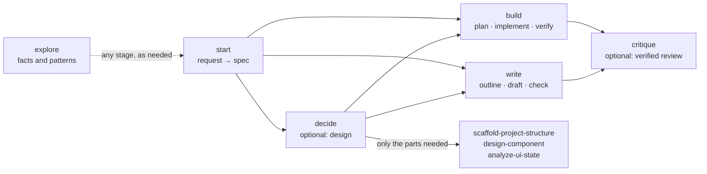

# my-spec — from a prompt to the final output

A workflow for Claude Code and GitHub Copilot that stays at the level of goals, decisions and
structure. The stack, libraries and conventions come from your project (found by `explore`) or from
you; installed stack skills (for example my-react's) handle the stack-specific parts.



- **Fast track** — a small, clear change: a short spec shown inline, then straight to build or write;
  nothing saved, no plan, no gates.
- **Full track** — everything else: `spec.md` and `design.md` saved in one task folder, a gate after
  spec, design, plan and review (`gates auto` in the spec skips them).

## Skills

| Skill | Does |
|---|---|
| `/my-spec:start <request>` | Looks before asking, asks ≤3 questions with defaults, writes the spec ([template](templates/spec.md)) and picks the track and route. |
| `/my-spec:explore <question>` | Anchored facts, the patterns to follow (with exemplar paths) and gaps, within a read budget. |
| `/my-spec:decide [question]` | The approach (2–3 options, one recommendation) and only the design parts the task needs, reconciled into one [design.md](templates/design.md). |
| `/my-spec:scaffold-project-structure` | A layout by project kind ([archetypes](skills/scaffold-project-structure/references/archetypes.md)) with import rules; scaffolds a new one on your yes, or fits new code into an existing layout. |
| `/my-spec:design-component` | Components by the decision each hides: interfaces, dependency directions, where likely changes land; or one component's inside. |
| `/my-spec:analyze-ui-state` | Per screen, seven questions: origin, coupling, placement, lifecycle, sharing, derivation, transitions and animation; a navigation map, state tables and diagrams. |
| `/my-spec:build [requirements]` | Plan (full track), implement in the project's patterns, verify each requirement with evidence, then review and one fix round when `review on`. |
| `/my-spec:write [requirements]` | Outline, draft for the reader, done check. |
| `/my-spec:critique [code \| design \| doc]` | Only verified findings with evidence; verdict accept · accept with fixes · rework ([report](templates/review.md)); fixes go back to the skill that made the target. |

## Agents

| Agent | Model · effort | Role |
|---|---|---|
| `builder` | opus · medium | Session agent for code: `claude --agent my-spec:builder "<task>"`. Runs the stages; their skills hand wide reading to `explorer`, multi-part design to `designer`, review to `reviewer`. |
| `writer` | opus · medium | The same for documents, plans, reports and research. |
| `designer` | opus · high | Dispatched by decide when a design needs ≥2 of structure, components and UI state, or a new project; writes `design.md`, never code. |
| `explorer` | sonnet · low | Read-only fact-finding in a fresh context. |
| `reviewer` | opus · high | Independent review; never sees the author's reasoning, edits nothing. |

Copilot reads `reasoning-effort` (Copilot harness) and ignores the Claude model aliases, so its agents
run on the session model. Pass `--model` or `--effort` to override in Claude Code.

## Layout

```text
my-spec/
├── shared/conventions.md   # flow, ids, gate, stack order, saving, agents, diagrams
├── templates/              # spec.md · design.md · review.md
├── skills/<name>/SKILL.md  # one per stage or design part; archetypes under scaffold-project-structure
├── agents/                 # builder · writer · designer · explorer · reviewer
└── hooks/ + scripts/       # one routing hint per prompt; silent on gate replies
```

Every path inside a skill is relative to the plugin root. Claude Code expands `${CLAUDE_PLUGIN_ROOT}`
in skill and agent bodies; Copilot does not, so each skill also says the root is two folders above it.

## Saving

Only the full track saves, and only `spec.md` and `design.md`, in one task folder: a path you name,
else the spec's `save` line, else a location your context files name (CLAUDE.md, AGENTS.md, README, a
docs folder); none → the skill asks once, proposing `.docs/<task>/` (git-ignored unless you want it
committed). Plans and reviews stay in chat unless you ask.

## Install

From a clone: `python3 setup.py install --tools claude,copilot --plugins my-spec`. Needs Claude Code
2.1.219 or later (agent effort, `${CLAUDE_PLUGIN_ROOT}` in agent bodies, nested agents). Installing
`my-spec` removes an old `think` install from each tool. In VS Code, a spawned agent dispatches further
agents only with `chat.subagents.allowInvocationsFromSubagents` on; otherwise it runs the skill inline.

## Changes from 0.8

- One `shared/conventions.md` replaces seven shared docs; three root `templates/` replace the
  per-skill templates; skills keep only their steps and a short check list.
- Removed: separate view files (`ui-state.md`, `project-structure.md`, `components.md`), check-row
  reports, the Translate step and its per-stack enforcement table, explore's saved notes. Design parts
  write sections of one `design.md`; stack details come from your project and installed skills.
- New: the fast track; model and effort per agent; each skill says when to hand work to `explorer`,
  `designer` or `reviewer`; build's first task makes a new layout's scaffold.
