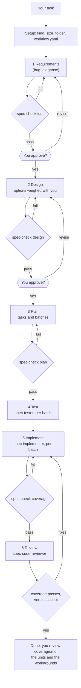
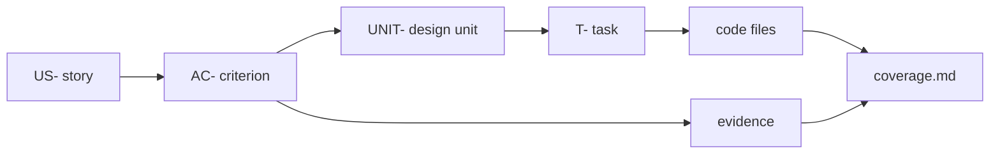
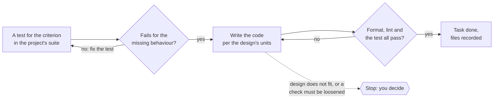
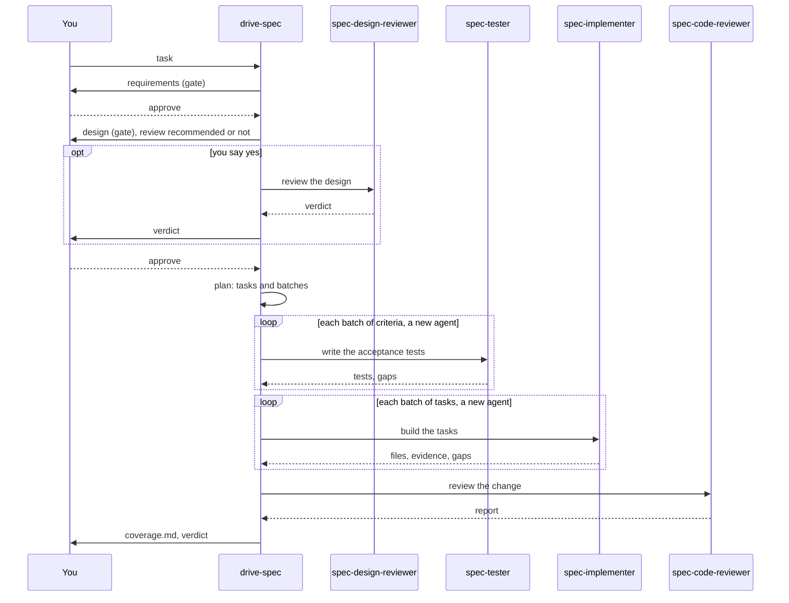

# my-workflow: how it is built, and why

For install and commands see [README.md](README.md). This document explains the design: the problem,
the two ideas behind every choice, and then each skill, agent and technique as **what** it is,
**why** it exists and **how** it works.

- [1. The problem](#1-the-problem)
- [2. Two ideas](#2-two-ideas)
- [3. The workflow at a glance](#3-the-workflow-at-a-glance)
- [4. The skills](#4-the-skills)
- [5. The agents](#5-the-agents)
- [6. The techniques](#6-the-techniques)
- [7. What was left out](#7-what-was-left-out)
- [8. Limits](#8-limits)
- [9. The rule for adding anything](#9-the-rule-for-adding-anything)
- [Appendices](#appendix-a-ids)

## 1. The problem

A developer used to trust code because they wrote it. Writing it built the knowledge that made it
trustworthy. Agents now do the writing, faster than a person can review, so that source of trust is
gone and the developer's leverage moves upstream, to the requirements and the design.

| Stage | Before | With agents |
|---|---|---|
| Requirements | stakeholders, product managers | the same, plus **developers** |
| Design | architect | architect, **developers** |
| Plan | project managers | developers with agents |
| Implement | developers | **agents** |
| Test | QA | agents, checked by script where possible |
| Review | architect, staff developers | humans, reading verification evidence |

This creates four risks.

| Id | Risk |
|---|---|
| R1 | Output arrives faster than humans can review it. |
| R2 | Nothing reliably confirms the output meets the requirements. |
| R3 | Code quality is hard to judge. |
| R4 | Humans can hardly continue the work if the models become unavailable. |

Each part below names the risks it answers, beside its **Why**.

| Risk | Skills | Agents | Techniques |
|---|---|---|---|
| R1 | `drive-spec` · `spec-design` · `spec-plan` · `discuss` | `spec-implementer` · `spec-design-reviewer` | two human gates · slices, test first · decide in the session, build in agents · the agent prompt · two sizes |
| R2 | `drive-spec` · `spec-requirements` · `spec-diagnose` · `spec-plan` · `rephrase` | `spec-tester` · `spec-code-reviewer` | criteria with evidence · stable ids · a script decides when a step is done · slices, test first · decide in the session, build in agents · batches and fresh agents · the agent prompt · standing rules live in the agent's definition |
| R3 | `spec-design` · `audit-truth` · `design-component` · `analyze-ui-state` · `scaffold-project-structure` | `spec-implementer` · `spec-design-reviewer` · `spec-code-reviewer` | a script decides when a step is done · bounded units and one diagram · decide in the session, build in agents · batches and fresh agents · roles: domain, discipline, level · standing rules live in the agent's definition · approved workarounds · the atlas of existing code |
| R4 | `spec-design` · `audit-truth` · `design-component` · `scaffold-project-structure` | `code-auditor` | stable ids · bounded units and one diagram · approved workarounds · the atlas of existing code · grounding by cost |

The goal: a workflow for any language whose results can be verified and maintained, so a person
steers the direction and trusts the outcome without reading every line.

## 2. Two ideas

An agent saying "done" is not a reason to trust the work. Two things are.

**Evidence about behaviour.** Something that can be run again, or something recorded that a person
can judge.

**Where a rule lives.** A rule is only as reliable as what enforces it. From strongest to weakest:

1. the project's own tools: tests, linter, type-checker;
2. one script that reads the spec files and decides whether a step may end;
3. written instructions to an agent, kept for judgement no tool can make.

A rule belongs in the strongest layer that can hold it.

## 3. The workflow at a glance

One skill, `drive-spec`, runs a task from request to accepted code. It keeps the work in a folder,
`specs/<task>/`, and moves through six steps. The person decides in the first three; agents build
and judge in the last three.

The steps are the same for every kind of task; what each produces differs.

| Step | Run by | Feature | Bug | Improvement |
|---|---|---|---|---|
| 1 | the session: `spec-requirements` · `spec-diagnose` | stories and criteria | reproduction, root cause, fix options | current value, target, what must not change |
| 2 | the session: `spec-design` | units and their diagram | only when a choice is open | only when a choice is open |
| 3 | the session: `spec-plan` | tasks and batches | the fix, covering its neighbours | steps each shippable alone |
| 4 | `spec-tester` | a failing test per criterion | the failing reproduction | invariants passing, the target failing |
| 5 | `spec-implementer` | the tasks, against the tests | the fix | each step, tests passing after it |
| 6 | `spec-code-reviewer` | evidence rerun, code review | reproduction rerun, regression | behaviour preserved, target measured |

## 4. The skills

A skill is a set of instructions the session loads when the work calls for it. Five form the
workflow; six work alone and are also called by the workflow's steps.

### drive-spec

- **What:** the driver. It decides the kind of task, creates the spec folder, runs the steps in
  order, asks for the two approvals, hands work to agents and checks what comes back.
- **Why · R1, R2:** without one owner of the order, a step is skipped or a check is forgotten. Keeping the
  order in one skill lets every other skill and agent stay small and know only its own job.
- **How:**
  - `workflow.yaml` is the state: the steps, their status, the gates, which agent runs a step and
    which skills it may use. Resuming is reading that file.
  - Each step runs the same seven moves: skip or not, run, record what an agent sent back, verify
    with the script, settle what needs the person, ask the gate, close.
  - What is needed only sometimes sits in reference files read on first use: the spec rules, size
    and folder, the agent prompt template, how to handle a change of direction.

### spec-requirements

- **What:** turns a request into user stories and acceptance criteria, each with a stable id. For
  an improvement it records the current value, the target and what must not change.
- **Why · R2:** a requirement written as a paragraph cannot be checked. A criterion written so that
  a tester could write its test from it alone can.
- **How:** it grounds itself in the code, asks what is unclear before writing, and writes each
  criterion as one sentence, `When <trigger>, <observable result>`, at the outermost surface. A
  spec with more than about twelve criteria is split.

### spec-diagnose

- **What:** the first step for a bug. It reproduces the fault, traces it to where it starts and
  proposes fixes, without changing source.
- **Why · R2:** a fix aimed at where a fault surfaces, not where it starts, moves the bug.
- **How:** smallest failing steps, read inward from the symptom to the first wrong state, a cause
  with evidence and a stated confidence, then a diagnosis (valid, needs reproduction, not a bug).
  Its criteria are the reproduction passing and each neighbour still holding.

### spec-design

- **What:** decides how to build: the approach, the units and how they depend on each other.
- **Why · R1, R3, R4:** design is the last cheap place to change direction, and a design nobody can read cannot
  be approved.
- **How:**
  - Options are weighed in the conversation. The file records only what the person chose.
  - The design is a short table of units and one dependency diagram.
  - Detail is written only where needed: a unit's boundary or inside, and always the interface of
    a surface that is new or changed, because the tests are written from it.
  - It calls `design-component`, `scaffold-project-structure` and `analyze-ui-state` for the parts
    they own.

### spec-plan

- **What:** breaks the design into ordered tasks, and groups the criteria to test and the tasks to
  build into batches.
- **Why · R1, R2:** a large change is hard to review and hard to stop halfway. And an agent given too
  much loses track, so the work must be cut to what one agent can hold.
- **How:**
  - A task is a vertical slice: it makes at least one criterion's evidence pass and leaves the
    project working. A slice that crosses domains becomes a task per domain, the provider first.
  - A batch holds one domain: about three tasks that touch the same units, or about five criteria
    of one story. Each batch records its domain and the tools it touches.
  - The plan is the map from each criterion to the files that realise it.

### audit-truth

- **What:** maps existing code into an atlas: units, what each depends on, owns and provides.
- **Why · R3, R4:** a design made against code that was guessed at often cannot be built.
- **How:** three modes. `build` maps a scope top-down along its dependencies. `query` answers from
  the atlas and, on a miss, reads exactly that spot and adds it. `distill` lifts units from
  another atlas with no source read. See [the atlas](#the-atlas-of-existing-code).

### design-component

- **What:** splits a system into units and decides which way each dependency points.
- **Why · R3, R4:** unit boundaries decide how much a later change costs.
- **How:** it lists the changes the requirements make likely, gives each unit one decision to hide,
  points dependencies at what changes less, then walks each change: it should touch one unit.

### analyze-ui-state

- **What:** decides, for each piece of UI state, where it comes from, who owns it, how long it
  lives, how it is shared and how it changes.
- **Why · R3:** most UI defects are state defects: two owners of one fact, or state that outlives its
  screen.
- **How:** per screen it lists the facts shown or edited, groups those that change together, and
  decides each group only where no existing pattern already answers.

### scaffold-project-structure

- **What:** lays out folders and import rules by the project's domain, or fits new code into an
  existing layout.
- **Why · R3, R4:** where code lives decides what may depend on what; a layout with no rules decays.
- **How:** one layout per domain in a reference table, import rules with the tool that enforces
  them, and scaffolding only when called directly and after a yes.

### discuss

- **What:** talks a problem through over several turns and ends with a direction a later session
  can turn into a spec.
- **Why · R1:** some decisions are not ready for requirements; forcing them into a spec hides the
  choice.
- **How:** each round frames, researches, weighs two or three options with a recommendation, and
  keeps a ledger of what is settled and what is open.

### rephrase

- **What:** restates a long or vague prompt as its objective, must-haves and open questions, with a
  shorter prompt ready to send. It never carries out the prompt.
- **Why · R2:** a long message mixes goals with background, and the agent may pick the wrong one.
- **How:** it reads only what the prompt names, sorts each part (must, constraint, decided,
  context, noise) and asks at most three questions.

## 5. The agents

An agent is a separate context with its own definition. It starts with none of the session's
conversation, which is the point: it cannot inherit the author's assumptions.

| Agent | Does | Never sees | Writes | Model · effort |
|---|---|---|---|---|
| `spec-tester` | one batch of acceptance tests, before the code | the plan, product code written for the spec | test files | session |
| `spec-implementer` | one batch of tasks, against those tests | — | product code; tests when none were given | session |
| `spec-design-reviewer` | checks a design before it is approved | the author's reasoning | nothing | opus · high |
| `spec-code-reviewer` | reruns the evidence and gives the verdict on a change | the author's reasoning | nothing | opus · high |
| `code-auditor` | builds an atlas of a codebase, in its own session | — | the atlas | opus · low |

Copilot ignores the model names and runs agents on the session model.

### spec-tester

- **What:** writes one black-box test per criterion in the project's own suite.
- **Why · R2:** a test written by the author of the code can pass for the wrong reason. A test
  written first, from the criterion alone, proves the criterion and not the implementation.
- **How:** it finds the test setup, tests at the outermost surface the criterion names, and runs
  every test before any code exists. A test must fail on its assertion for the missing behaviour;
  an invariant or a bug's neighbour must pass. A surface defined nowhere is sent back as a gap.

### spec-implementer

- **What:** builds a batch of tasks, in the project's patterns and under its linter.
- **Why · R1, R3:** the session that discussed the work with the person is the wrong place to build it: its
  context is needed for the person's questions, and it carries opinions the code should not need.
- **How:** it reads the design of the units it touches, sees the tests fail, builds task by task
  and verifies each. It stops at a gap and never works around one: a design that does not fit, a
  change outside its units, a check that would have to be loosened. Its coding principles (think
  first, simplest thing, surgical changes, a named check for done) are part of its definition.

### spec-design-reviewer

- **What:** an independent read of a design before any code exists.
- **Why · R1, R3:** the session writes the design in the same conversation that discussed it, so it shares
  the person's blind spots.
- **How:** seven checks, each needing an anchor. The one no code review can do is **fit**: it opens
  every unit the design says it modifies or reuses and confirms the code provides what the design
  takes from it. It runs only when the person says yes, or, when they granted the gates in
  advance, when the session judges the design heavy.

### spec-code-reviewer

- **What:** the verdict on a change: accept, accept with fixes, or rework.
- **Why · R2, R3:** an author's review inherits the author's blind spots.
- **How:** it reruns the evidence, the linter and the existing tests, repeats each observation, and
  reviews against the spec, the project's rules and the design. It reproduces each finding or
  marks it unverified, and names what would prevent the issue's whole class: a lint rule, a type
  or a test. When an atlas exists, it compares each changed unit with its entry to find a boundary
  that moved without the design saying so.

### code-auditor

- **What:** a session agent that agrees a scope with you, builds an atlas and answers from it.
- **Why · R4:** understanding unfamiliar code is a job of its own, best done before a spec starts and
  in a context that is not also trying to change the code.
- **How:** it runs `audit-truth` in one context and ends with one line to paste into a new session.

## 6. The techniques

### Criteria with evidence

- **What:** every requirement is a one-sentence criterion with an id, and every criterion carries
  one evidence line.
- **Why · R2:** "it works" must mean something a person or a script can check.
- **How:** the evidence is the strongest kind that fits:
  1. a test in the project's own suite;
  2. an existing project command that fails when the criterion does not hold;
  3. an observation: the product was run and what was seen is recorded.

  A test in the suite keeps guarding the behaviour after the spec is closed. A script written only
  for the spec would be thrown away, so none is ever written. Observation is the weakest kind and
  the report marks it "yours to judge".

### Stable ids

- **What:** stories, criteria, units, tasks and workarounds each have an id that is defined once.
- **Why · R2, R4:** a script cannot follow a requirement to its code through prose.
- **How:** an id is the first cell of a table row or the start of a heading; everything else
  refers to it. Ids are never reused or renumbered.

### A script decides when a step is done

- **What:** `scripts/spec-check.py` reads the spec files and exits non-zero when something is
  missing. No step ends while it fails.
- **Why · R2, R3:** an agent that judges its own step complete is sometimes wrong and sounds the same either
  way. An exit code cannot be argued with.
- **How:**

  | After | It fails when |
  |---|---|
  | requirements | an id is defined twice or never; a story has no criterion |
  | design | a unit has no responsibility; the diagram and the unit list disagree; a diagram shows more than six units; there is a dependency cycle; a criterion is delivered by no unit |
  | plan | a criterion or changed unit is served by no task; a task sits in no implement batch, or in two |
  | implement, review | a criterion is not built, or its evidence does not pass |

  It also writes `coverage.md`, the report the person reviews. It checks only what a script can
  decide; whether a test truly proves its criterion stays a judgement.

### Two human gates

- **What:** the person approves the requirements (for a bug, the diagnosis) and the design before
  any code is written.
- **Why · R1:** these are the two cheapest places to change direction and the two steps where the
  person's judgement cannot be replaced. After them the criteria define "right".
- **How:**
  - Anything that needs an answer leads the reply under a **Needs you** line, because a file can
    record a question but cannot ask it.
  - A step's questions are asked before its artifact is saved. An answer, or a default taken,
    becomes a decision; a spec file never holds an open question, and the gate shows the defaults.
  - Saying "just do it" grants the gates in advance: a passing check then approves. It never
    covers a workaround.

### Bounded units and one diagram

- **What:** a design is a table of units and one dependency diagram.
- **Why · R3, R4:** someone taking the work over needs three answers: what exists, what each part owns, and
  what depends on what.
- **How:** each unit has one responsibility it solely owns. Dependencies are stated once, in the
  diagram, so no two documents have to agree. A diagram holds at most six units; past that it
  stops being read, so a larger design is split into groups.

### Slices, test first

- **What:** work is planned as slices that each leave the project working, and inside a task the
  test comes before the code.
- **Why · R1, R2:** a slice that works alone is small enough to review and safe to stop after. A test seen
  failing first proves the test can fail.
- **How:**

### Decide in the session, build in agents

- **What:** the session never writes a test or a review, and writes product code only as a
  trivial fix of a few lines.
- **Why · R1, R2, R3:** independence is the cheapest check on an author, and the session's context is the
  scarce resource the person needs for their own decisions.
- **How:**

  What an agent sends back is a claim. The session records it, reruns the commands itself, and
  puts any gap or question to the person before the next batch starts.

### Batches and fresh agents

- **What:** tests and tasks go out in small batches, each to a new agent, one at a time.
- **Why · R2, R3:** an agent whose context keeps growing loses track of what it was told. A new agent
  reading the files the earlier ones left starts clear.
- **How:** the plan defines the batches. New work always gets a new agent, a fix round after a
  review included. An agent is continued only to finish or correct its own batch, and a review's
  second round continues its reviewer, because both are still the same piece of work. Agents never
  receive each other's prose; a later one reads the files.

### The agent prompt

- **What:** every hand-off is one prompt in one format: Role, Goal, The work, What I know, Skills,
  Done.
- **Why · R1, R2:** an agent starts with nothing, so the prompt is all it has. It is written the way you
  would brief a teammate who knows the craft: why the work matters, what is theirs, what you
  already know and what you need back. One format also lets a person read exactly what an agent
  was told.
- **How:**

  | Section | Holds |
  |---|---|
  | Role | who the agent is for this work |
  | Goal | why it matters, the outcome that ends the run, and the one thing easy to get wrong |
  | The work | the items with their ids; what is not theirs; how much is their call |
  | What I know | where to read, facts already established, binding decisions with their reasons |
  | Skills | the skills that fit this work's tools |
  | Done | the command that shows it is done, and exactly what to send back |

  The prompt is sized to the work and written once, straight into the agent call.

### Roles: domain, discipline, level

- **What:** the Role line is built, not improvised:
  `You are a <level> <discipline> <title> working in <tools>, <job>. Your concerns: <concerns>.`
- **Why · R3:** naming the domain and stack focuses the agent on that domain's idioms. Building the
  line from tables keeps it consistent and stops it shrinking to a bare "senior developer".
- **How:**
  - **Domain and discipline** come from one shared table: UI app, backend service, CLI, library,
    data pipeline, plugin, workspace, data change. The table also lists typical concerns per
    domain. They are examples, so a role names only the few its work touches.
  - **Title and job** come from the agent: test engineer, engineer, architect, code reviewer.
  - **Level** comes from the work's reach, and sets how much is the agent's call:

    | Level | The work | Its call |
    |---|---|---|
    | senior | inside units the design specifies | how each task is built |
    | staff | spans three or more units, changes a shared contract, or improves existing units | also choices the design leaves open inside its units |
    | lead | spans domains | also how its units work together, within their contracts |

  The task list, a unit's boundary and a contract are never an agent's call at any level: those
  come back as gaps. The same domain table tells a design what it usually has to answer, and a
  batch never mixes domains.

### Standing rules live in the agent's definition

- **What:** rules that hold on every run (do not edit the spec's files, where probe files go, how
  to treat the atlas, anchor every fact, send questions back) are in each agent's definition.
- **Why · R2, R3:** a definition is loaded before any prompt. Copying the same rules into every prompt
  costs the session tokens on each hand-off and risks paraphrasing them.
- **How:** each of the four spec agents ends with an "In a spec" block that applies when its prompt
  names a `workflow.yaml`. Called directly, with no spec, an agent works from the request alone.

### Approved workarounds

- **What:** a shortcut needs the person's approval and is recorded with its reason and the
  condition for removing it.
- **Why · R3, R4:** when a design does not fit the code, the easy path is a quiet shortcut: a suppressed
  lint, a loosened test. The next agent copies whatever the codebase contains, so the shortcut
  becomes the pattern.
- **How:** the agent stops and sends the gap back. A criterion that cannot be evidenced needs a
  waiver, approved the same way. The script fails while either is unapproved.

### The atlas of existing code

- **What:** a saved map of existing code, read in three tiers: an index with the dependency graph,
  then one entry per unit, then the source through anchors.
- **Why · R3, R4:** every step grounds itself in the same map instead of exploring again, and the map is
  something a person can read.
- **How:**
  - A unit is `Unit = F(Unit_A, Unit_B, …)`: the units it depends on and what it takes from each,
    the logic it solely owns, and what it provides for others.
  - Each dependency is written once, by the unit that depends. Who uses a unit is a lookup, not a
    stored fact.
  - The atlas is a snapshot of the code as audited. It grows and is never rewritten to follow a
    spec's changes. That is what lets a reviewer compare "before" with the diff, and writing each
    dependency once is what lets it grow without edits to what is already there.

### Grounding by cost

- **What:** one rule for how to read existing code, shared by every skill.
- **Why · R4:** mapping an area costs far more than finding one line; using the heavy tool for a small
  question wastes context.
- **How:** an atlas exists → ask it first. None → grep and read. An atlas is built only for a
  design that builds on or changes three or more existing units, an improvement to existing
  units, or a question about how units work together.

### Two sizes

- **What:** a small task runs "light": the design sits in the spec file, there is one gate, and no
  separate tester.
- **Why · R1:** the full flow would cost more than a small change is worth.
- **How:** `drive-spec` sets the size at setup, or you say "quick" or "deep". At light size the
  implementer writes each failing test first. Steps and numeric limits are defaults the agent may
  skip or exceed with a one-line reason; rules worded "never" or "only with approval" are not.

### Written for the reader that pays per token

- **What:** skills and agent definitions are short, and each rule is stated once.
- **Why · supports every part:** an agent reads a skill every time it triggers, so every line has a cost, and a rule
  stated twice will one day disagree with itself.
- **How:** shared conventions sit in one file; detail needed only sometimes sits in reference files
  read on first use; file formats are templates in each skill's `assets/`.

## 7. What was left out

Each of these was built or considered, then removed because nothing showed it helped.

- **A check script per spec.** Evidence belongs in the project's own suite.
- **Spec ids inside product tests.** They go stale once the spec is closed.
- **A required "functionality" layer** between criteria and units. It is optional (`FN-1`).
- **Input and output prose per unit.** It repeated the diagram's edges.
- **Parallel batches.** Speeding up a loop that has not yet proven itself adds risk.
- **A design agent.** Design is where the person's judgement is needed; an agent in between only
  relayed options and answers.
- **Implement and review as skills the session runs.** The session that discussed the work is the
  wrong context to build or judge it in.
- **Workflow rules copied into every prompt.** They are loaded first, and for free, from the
  agent's definition.
- **Design levels, per-step model settings, a prompt-routing hook.** The model, the agent
  definitions and the skill descriptions already handle these.

## 8. Limits

- Evidence shows a criterion holds. It cannot show the criterion was the right one to write.
- A gate is only as good as the attention given to it. Short artifacts are the main defence.
- The script confirms that evidence exists and passes. Whether a test truly proves its criterion,
  and whether a design is good, remain judgements.
- "It failed first" is a written rule; nothing scripted proves it.
- A reviewer is still a model: its findings count only when reproduced. An agent that starts from
  nothing is only as good as the artifacts and the prompt it is given.
- An agent must recognise that it is taking a shortcut. That is judgement, backed by the reviewer.
- The atlas is the least proven part: nothing yet measures how much exploration it saves.
- **The workflow has not yet been run end to end on a real task.** The script has been run on
  sample specs; everything else in this document is reasoned, not measured.

## 9. The rule for adding anything

The plugin does not try to make agents trustworthy. It makes their output checkable. It stays small
by one rule:

1. If the project's tools can hold it, it belongs in the project, not here.
2. If the script can hold it, it goes in the script, with a helpful failure message.
3. Otherwise it is a written instruction, and it needs evidence: a failure it would have prevented,
   or a decision by the team.

## Appendix A. Ids

| Id | Is | Lives in |
|---|---|---|
| `US-1` | user story | `spec.md` |
| `AC-1.1` | acceptance criterion of `US-1` (`AC-7`: standalone, no story) | `spec.md` |
| `FN-1` | functionality, optional: one capability that serves several criteria | `spec.md` |
| `R-1` | limit: a hard number or a never-event | `spec.md` |
| `WA-1` | approved workaround | `spec.md` |
| `UNIT-1` | design unit | `design.md` |
| `T-1` | task | `tasks.md` |
| `TB-1` · `IB-1` | test batch · implement batch | `tasks.md` |
| `I-1` | review issue | the review report |

## Appendix B. The spec folder

`specs/<task>/`, git-ignored unless you want it committed, or under a location you name.

| File | Written by | Holds |
|---|---|---|
| `workflow.yaml` | `drive-spec`, then each step | kind, size, branch, artifact paths, each step's status and gate |
| `spec.md` | step 1 | stories, criteria with their evidence, limits, decisions, approved workarounds and waivers |
| `design.md` | `spec-design` | the chosen approach, the units, the dependency diagram, decisions |
| `design/` | `spec-design` | only when needed: a file per group of units, plus contracts, screens and flows |
| `tasks.md` | `spec-plan` | the tasks with their ids and files; the batches and their status |
| `coverage.md` | `spec-check` | per criterion: built, evidenced, the files |
| `review.md` | `drive-spec`, from the code reviewer's latest report | written once a round is not accepted |
| `atlas/` | `audit-truth` | a snapshot of the existing code this spec touches |
| `discussions.md` | `drive-spec` | only once you have discussed something: what was weighed and why the rest lost |
| `scratch/` · `evidence/` | the steps and agents | probes and measurements; output an observation cites |

## Appendix C. Where things are

| Path | Holds |
|---|---|
| `skills/drive-spec/` | the driver; `references/` has the spec rules, the agent prompt template, size and folder rules, steering; `assets/workflow.yaml` is the state template |
| `skills/spec-*/` | the four steps the session runs; each `assets/` holds the file formats the script reads |
| `skills/` (others) | `audit-truth`, `design-component`, `analyze-ui-state`, `scaffold-project-structure`, `discuss`, `rephrase` |
| `agents/` | the four spec agents and `code-auditor` |
| `shared/conventions.md` | what every skill follows: anchors, units, grounding, questions, output |
| `shared/domains.md` | the domains, with each one's discipline and typical concerns |
| `scripts/spec-check.py` | the gates |
