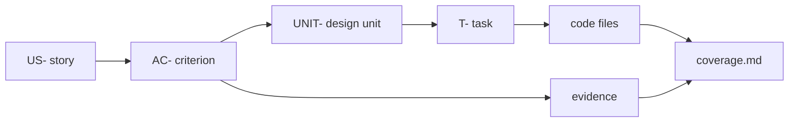
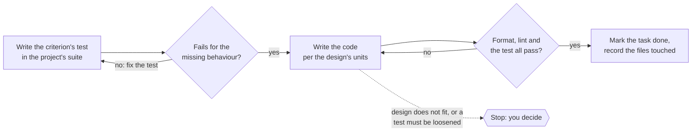
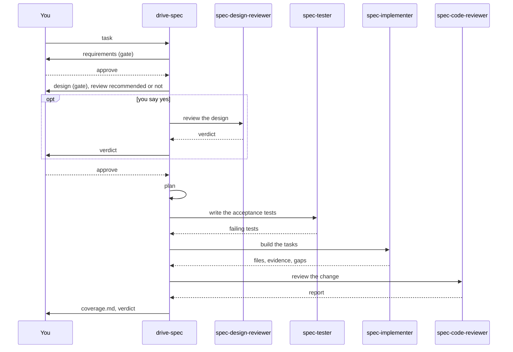
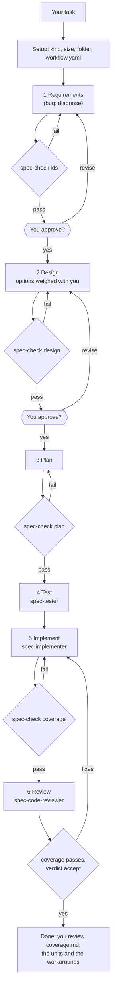

# my-workflow: a development workflow for trusting agent-written code

For install and commands see [README.md](README.md).

## Abstract

Coding agents now write software faster than people can review it. The person who used to trust
code because they wrote it must now trust code they did not write. my-workflow is a plugin for
Claude Code and GitHub Copilot that answers this with one claim: **trust should rest on evidence
about behaviour, and each rule should be enforced by the strongest thing able to enforce it.** The
plugin turns that claim into eight mechanisms: criteria backed by evidence, two human gates, a
script that decides each step's gate, a design made of bounded units, working slices built test
first, agents that build and judge in their own context, approved workarounds, and a map of
existing code. This document
states the problem, explains each mechanism and why it has its shape, and names what the design
cannot do.

## 1. Introduction

Software work has a familiar shape: requirements, design, plan, implement, test, review. For decades
the developer who wrote the code could stand behind it, because writing it built the detailed
knowledge that made it trustworthy. Confidence was a by-product of authorship.

Agents can now do the implementing. That removes authorship as the source of confidence and moves
the developer's leverage upstream: clear requirements and a good design are how a person steers
what an agent builds.

| Stage | Before | With agents |
|---|---|---|
| Requirements | stakeholders, product managers | stakeholders, product managers, **developers** |
| Design | architect | architect, **developers** |
| Plan | project managers | developers with agents |
| Implement | developers | **agents** |
| Test | QA | agents, checked by script where possible |
| Review | architect, staff developers | humans, reading verification evidence |

The shift creates four risks:

| Id | Risk |
|---|---|
| R1 | Output arrives faster than humans can review it. |
| R2 | Nothing reliably confirms the output meets the requirements. |
| R3 | Code quality is hard to judge. |
| R4 | Humans can hardly continue the work if the models become unavailable. |

The goal is a workflow for any language whose results are verifiable, deterministic where possible
and maintainable, so a person can steer the direction and trust the outcome without reading every
line.

## 2. Approach

An agent saying "done" is not a reason to trust the work. Two things are.

The first is **evidence about behaviour**: something that can be run again, or something recorded
that a person can judge.

The second is **where a rule lives**. A rule is only as reliable as what enforces it. In order of
strength:

1. the project's own tools: tests, linter, type-checker;
2. one script that reads the spec files and decides each step's gate;
3. written instructions to the agent, kept for judgement no tool can make.

A rule belongs in the highest layer that can hold it. Each mechanism below applies one of these two
ideas to one or more of the risks.

| § | Mechanism | Risks |
|---|---|---|
| 3 | Criteria with evidence | R2 |
| 4 | Two human gates | R1 |
| 5 | A script decides the gates | R2, R3 |
| 6 | Bounded units and one diagram | R3, R4 |
| 7 | Working slices, test first | R1, R2 |
| 8 | Decide in the session, build in agents | R1, R2, R3 |
| 9 | Approved workarounds | R3, R4 |
| 10 | An atlas of existing code | R4 |

## 3. Criteria with evidence

**Problem.** A requirement written as a paragraph cannot be checked. "It works" is whatever the
author says it is.

**Mechanism.** Each requirement becomes a one-sentence acceptance criterion, `When <trigger>,
<observable result>`, with a stable id such as `AC-1.2`. A criterion may belong to a user story
(`US-1`) or stand alone. Each carries exactly one evidence line, the strongest kind that fits:

1. a test in the project's own suite;
2. an existing project command that fails when the criterion does not hold, such as a build or
   type-check;
3. an observation: the product was run, and what was seen is recorded.

Ids make the path from requirement to code traceable:

**Rationale.** A test in the suite keeps guarding the behaviour after the spec is closed, and it
survives the agent's context being lost. A script written only to satisfy a spec would be thrown
away, so the workflow never writes one. Observation is allowed because some behaviour has no
harness; it is the weakest kind, and the report marks it "yours to judge".

**Limit.** Evidence shows a criterion holds. It cannot show the criterion was the right one to
write.

## 4. Two human gates

**Problem.** A person cannot review everything, and correcting direction after the code exists is
the expensive moment to do it.

**Mechanism.** The person approves two things before any code is written: the requirements (for a
bug, the diagnosis) and the design. Before each gate the agent settles what is open: questions with
their defaults, options to choose between, conflicts with what the person said. Design options are
weighed in conversation; the design file records only what was chosen. Anything that needs an
answer leads the reply under a **Needs you** line, because a file can record a question but cannot
ask it.

**Rationale.** These are the two cheapest places to change direction, and the two steps where the
person's judgement cannot be replaced. After them the criteria define "right", so the remaining
steps are gated by the script alone. A person may grant the gates in advance ("just do it"), in
which case a passing check approves.

**Limit.** A gate is only as good as the attention given to it. Keeping the artifacts short is the
design's main defence.

## 5. A script decides the gates

**Problem.** An agent that judges its own step complete will sometimes be wrong, and will sound the
same either way.

**Mechanism.** `scripts/spec-check.py` reads the spec files and exits non-zero when something is
missing. No step is done while it fails.

| After | It fails when |
|---|---|
| requirements | an id is defined twice or never; a story has no criterion |
| design | a unit has no responsibility; the diagram and the unit list disagree; a diagram shows more than six units; there is a dependency cycle; a criterion is delivered by no unit |
| plan | a criterion or changed unit is served by no task |
| implement, review | a criterion is not built (its tasks done, their files in the repo) or its evidence does not pass |

It also writes `coverage.md`, the report the person reviews: per criterion, whether it is built and
what evidence backs it.

**Rationale.** An exit code cannot be argued with. The script checks only what a script can
decide and leaves the rest labelled as judgement.

**Limit.** It confirms that evidence exists and passes. It does not judge whether a test truly
proves its criterion or whether a design is good.

## 6. Bounded units and one diagram

**Problem.** Code nobody understands cannot be judged or taken over.

**Mechanism.** The design is a short table of units. Each unit has one responsibility it solely
owns, an anchor in the code, and the criteria it delivers. One dependency diagram shows what
depends on what, with at most six units; a larger design splits into groups. Further detail, such
as a boundary or an interface, is written only for the units that need it.

**Rationale.** Someone taking the work over needs three answers: what exists, what each part owns,
and what depends on what. Dependencies are stated once, in the diagram, so no two documents have to
be kept in agreement. Six units is the point past which a diagram stops being read.

**Limit.** The script checks the shape of a design, not its quality. That remains the person's
judgement at the design gate.

## 7. Working slices, test first

**Problem.** A large change is hard to review and hard to stop halfway.

**Mechanism.** The plan is a list of tasks. Each task makes at least one criterion's evidence pass
and leaves the project working. Inside a task the test comes first:

**Rationale.** A slice that works on its own is small enough to review and safe to stop after. A
test seen failing first proves the test can fail. The task list doubles as the map from each
criterion to the files that realize it.

**Limit.** "It failed first" is a written rule. Nothing scripted proves it.

## 8. Decide in the session, build in agents

**Problem.** An author's tests can pass for the wrong reason, and an author's review inherits the
author's blind spots. A session that also writes the code spends its context on details, when the
person needs it for the two decisions only they can make.

**Mechanism.** The session settles the requirements, the design and the plan with the person, then
hands the rest to agents, each in its own context:

| Agent | Does | Never sees |
|---|---|---|
| `spec-tester` | writes one test per criterion before the code, each seen failing where behaviour is missing | the plan, the implementation |
| `spec-implementer` | builds the tasks in order against those tests | — |
| `spec-code-reviewer` | reruns the evidence, reproduces its findings or marks them unverified, gives the verdict | the author's reasoning |
| `spec-design-reviewer` | checks a design against the criteria and the code it builds on | the author's reasoning |

Every hand-off is one prompt in one fixed format: goal, tasks, context, facts, rules, skills,
verification. The rules that must hold are written into the prompt itself, copied word for word from
one list, so an agent starts with them and a person can read exactly what it was told. The prompt
also says when the agent is done and what it must deliver; the session treats that delivery as a
claim and runs the check itself.

The design review runs only when the person says yes. At the design gate the session says whether
it recommends one: a design is heavy when it has more than six units, changes several existing
units, departs from an existing pattern or spans several deployables.

**Rationale.** Independence is the cheapest check on an author, and here it comes from what each
agent is given, not from starting a new one every time: a follow-up continues the same agent, which
keeps what it learned. Context that the session does not spend on code stays available for the
person's questions. While this plugin was being built, a fresh-context review found 20
inconsistencies the authoring context had missed.

**Limit.** A reviewer is still a model. Its findings count only when reproduced. A context-free
agent is only as good as the artifacts and the prompt it is given.

## 9. Approved workarounds

**Problem.** When a design does not fit the code, the easy path is a quiet shortcut: a suppressed
lint, a loosened test, a special case. The next agent copies whatever the codebase contains, so the
shortcut becomes the pattern.

**Mechanism.** When the design cannot be built as written, or a test or lint would have to be
loosened, the agent stops and asks. An approved workaround is recorded with its reason and the
condition for removing it. A criterion that cannot be evidenced needs a waiver, approved the same
way. The script fails while either is unapproved, and granting the gates in advance never covers
them.

**Rationale.** A few recorded exceptions are maintainable. Unrecorded ones are how a design decays.

**Limit.** The agent must recognise that it is taking a shortcut. That is judgement, backed by the
reviewer.

## 10. An atlas of existing code

**Problem.** A design made against code that was guessed at often cannot be built.

**Mechanism.** `audit-truth` maps existing code as units. A unit is `Unit = F(Unit_A, Unit_B, …)`:
the units it depends on and what it takes from each, the logic it solely owns, and what it provides
for others to depend on. The map is saved and read in three tiers: an index with the dependency
graph, then unit entries, then the source through their anchors. Each dependency is written once,
by the unit that depends.

| Mode | Does |
|---|---|
| `build` | maps a scope top-down along its dependencies; smaller units are revealed only where a question needs them |
| `query` | answers from the atlas; on a miss reads exactly that spot and adds it |
| `distill` | lifts the relevant units from another atlas, with no source read |

An atlas is built only when the work must understand existing units to change them: a design that
builds on or changes three or more of them, an improvement to them, or a question about how they
work together. A location or a single claim is a grep. Once an atlas exists, every later step and agent asks it first.

The atlas is a snapshot of the code as audited. It grows; it is never rewritten to follow the
changes a spec makes. The reviewers use exactly that: the design reviewer checks that the code
provides what the design takes from it, and the code reviewer compares each changed unit with its
entry to find a boundary that moved without the design saying so.

**Rationale.** Every step grounds itself in the same map instead of exploring again, and the map
is something a person can read. Writing each dependency once, on the dependent's side, is what lets
the map grow without edits to what is already there.

**Limit.** This is the least proven mechanism. Nothing yet measures how much exploration it saves.

## 11. The workflow as a whole

`drive-spec` decides the kind of task (feature, bug or improvement), creates the spec folder and
runs the steps in order. The four step skills and the four agents also work on their own, without
a spec.

| Step | Run by | Feature | Bug | Improvement |
|---|---|---|---|---|
| 1 | `spec-requirements` · `spec-diagnose` | stories and criteria, clarified first | reproduce, root cause, fix options | current vs target; what must not change |
| 2 | `spec-design` | units and their diagram | only when a choice is open | only when a choice is open |
| 3 | `spec-plan` | tasks, each a working slice | the fix, covering its neighbours | steps each shippable alone |
| 4 | `spec-tester` | a failing test per criterion | the failing reproduction | invariants green, the target failing |
| 5 | `spec-implementer` | the tasks, against the tests | the fix | steps with tests green after each |
| 6 | `spec-code-reviewer` | evidence rerun, code review | reproduction rerun, regression | behaviour preserved, target measured |

The workflow scales down. A small task with an existing pattern to follow runs "light": the design
sits in the spec file, there is one gate, and no separate tester, so the implementer writes each
failing test first. A
trivial fix of a few lines the session may make itself. It also adapts: a decision the person states is kept, a claim the work
rests on is verified first, and steps and numeric limits are defaults the agent may skip or exceed
with a one-line reason. Rules worded "never" or "only with approval" are not defaults.

At the end the person reviews three things: `coverage.md`, the units with their diagram, and the
approved workarounds.

## 12. What was left out

Each of these was built or considered, then removed because nothing showed it helped:

- **A check script per spec.** Evidence belongs in the project's own suite.
- **Spec ids inside product tests.** They go stale once the spec is closed.
- **A required "functionality" layer** between criteria and units. It is optional (`FN-1`); most
  specs map criteria straight to units.
- **Input and output prose per unit.** It repeated the diagram's edges.
- **Parallel implementer agents.** One implementer works the plan in order. Speeding up a loop that
  has not yet proven itself adds risk.
- **A design agent.** Design is where the person's judgement is needed; an agent in between only
  relayed options and answers.
- **Implement and review as skills the session runs.** The session that discussed the work is the
  wrong context to build or judge it in.
- **"A fresh agent every time".** Independence comes from what an agent is given; discarding what
  it learned only costs.
- **Design levels, a senior or junior role, per-step model settings, a prompt-routing hook.** The
  model, the agent definitions and the skill descriptions already handle these.

## 13. Limitations

- The workflow cannot prove the requirements themselves are right.
- Whether a test truly proves its criterion, and whether a design is good, remain judgements made
  by the reviewer and the person.
- The mechanisms have been tested piece by piece, mainly the script on sample specs. **The workflow
  has not yet been run end to end on a real task**, so the claims in the rationale paragraphs are
  reasoned, not measured.

## 14. Conclusion

The plugin does not try to make agents trustworthy. It makes their output checkable: every
requirement is a criterion, every criterion has evidence, a script refuses to move on without it,
and a person approves the two decisions that set the direction. The design stays small by one rule
for adding anything:

1. If the project's tools can hold it, it belongs in the project, not here.
2. If the script can hold it, it goes in the script, with a helpful failure message.
3. Otherwise it is a written instruction, and it needs evidence: a failure it would have prevented,
   or a decision by the team.

## Appendix A. Ids

| Id | Is | Lives in |
|---|---|---|
| `US-1` | user story | `spec.md` |
| `AC-1.1` | acceptance criterion of `US-1` (`AC-7`: standalone, no story) | `spec.md` |
| `FN-1` | functionality, optional: one capability that serves several criteria | `spec.md` |
| `UNIT-1` | design unit | `design.md` |
| `T-1` | task | `tasks.md` |
| `R-1` | limit: a hard number or a never-event | `spec.md` |
| `WA-1` | approved workaround | `spec.md` |
| `I-1` | review issue | the review report |

## Appendix B. The spec folder

`specs/<task>/`, git-ignored unless you want it committed, or under a location you name.

| File | Written by | Holds |
|---|---|---|
| `workflow.yaml` | drive-spec, then each step | kind, size, branch, artifact paths, each step's status and gate |
| `spec.md` | step 1 | stories, criteria with their evidence, limits, decisions, approved workarounds and waivers |
| `design.md` | `spec-design` | the chosen approach, the units, the dependency diagram, decisions |
| `design/` | `spec-design` | only when needed: a file per group of units, plus contracts, screens and flows |
| `tasks.md` | `spec-plan` | tasks with the ids and files of each, progress |
| `coverage.md` | `spec-check` | per criterion: built, evidenced, the files |
| `review.md` | drive-spec, from the code reviewer's latest report, once a round is not accepted | evidence results, coverage gaps, issues |
| `atlas/` | `audit-truth` | a snapshot of the existing code this spec touches, as units |
| `discussions.md` | only once you have discussed something | what was weighed and why the rest lost |
| `scratch/` · `evidence/` | the steps | probes and measurements; output an observation cites |

## Appendix C. The parts of the plugin

| Part | What it holds |
|---|---|
| `drive-spec` | the order of steps, the gates, delegation, when to stop; its references hold the spec rules and the agent prompt template |
| Four `spec-*` skills | how each step the session runs is done: requirements, diagnose, design, plan |
| `shared/conventions.md` | what every skill follows: anchors, units, grounding, questions, output |
| Templates in each skill's `assets/` | the fixed file formats the script reads |
| `scripts/spec-check.py` | the gates |
| Standalone skills | `audit-truth`, `design-component`, `analyze-ui-state`, `scaffold-project-structure`, `discuss`, `rephrase` |

| Agent | Owns | Writes | Model · effort |
|---|---|---|---|
| `spec-tester` | the acceptance tests, before any code | test files in your suite | session |
| `spec-implementer` | the tasks, in order | product code; tests when none were given | session |
| `spec-design-reviewer` | the verdict on a design, on your yes | nothing | opus · high |
| `spec-code-reviewer` | the verdict on the change | nothing | opus · high |
| `code-auditor` | a codebase atlas; runs on its own | the atlas | opus · low |

Copilot ignores the model names and runs agents on the session model.
