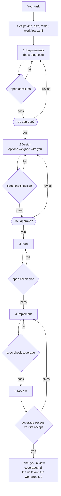
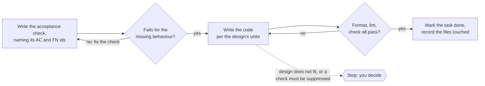
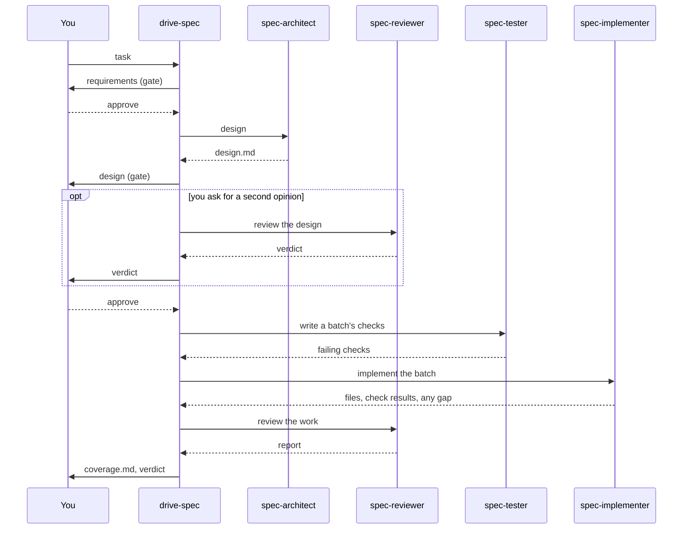
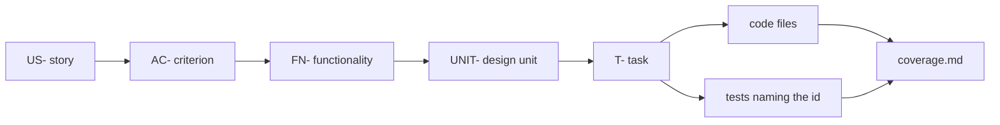

# my-workflow

A spec-driven software workflow for Claude Code and GitHub Copilot, for any language or framework. It
keeps you in control of code that agents write: you approve the requirements and the design, a script
proves each requirement has a passing test, and you review evidence instead of every line.

- [Why this workflow](#why-this-workflow)
- [Install](#install)
- [Drive a task](#drive-a-task-drive-spec)
- [How the work is verified](#how-the-work-is-verified)
- [The spec folder](#the-spec-folder)
- [Run one step](#run-one-step)
- [Standalone skills](#standalone-skills)
- [Map unfamiliar code first](#map-unfamiliar-code-first-code-auditor)
- [Your stack's skills](#your-stacks-skills)
- [Agents](#agents)
- [How it adapts](#how-it-adapts)

## Why this workflow

Software work has a familiar shape: requirements, design, plan, implement, test, review. For decades
the developer who wrote the code could stand behind it, because writing it built the detailed
knowledge that made it trustworthy. Confidence was a by-product of authorship.

Agents can now do the implementing. That removes authorship as the source of confidence, and it moves
the developer's leverage upstream: clear requirements and a good design are how a human steers what an
agent builds.

| Stage | Before | With agents |
|---|---|---|
| Requirements | stakeholders, product managers | stakeholders, product managers, **developers** |
| Design | architect | architect, **developers** |
| Plan | project managers | developers with agents |
| Implement | developers | **agents** |
| Test | QA | agents, checked by script where possible |
| Review | architect, staff developers | humans, reading verification evidence |

### Four risks

| Id | Risk |
|---|---|
| R1 | Output arrives faster than humans can review it. |
| R2 | Nothing reliably confirms the output meets the requirements. |
| R3 | Code quality is hard to judge. |
| R4 | Humans can hardly continue the work if the models become unavailable. |

### Three principles

- **Formalized verification.** Results are checked against the stories, criteria and functionalities
  written in the requirements and design, not against an agent's claim that it is done.
- **Design for maintainability.** The design is a set of units with clear responsibilities and
  boundaries, each small enough for a human to understand and take over, with few workarounds.
- **Deterministic where possible.** Where a script, lint or schema can decide, it decides. Where none
  can, a human or an AI judges, and the result is labelled as judged.

### How the workflow answers the risks

| Risk | Answer |
|---|---|
| R1 | You review a coverage report, a dependency diagram and bounded units, not every line. |
| R2 | Every requirement has an id, a test that names it and the code files that realize it; a script reports the gaps. |
| R3 | The code runs under your linter and formatter, follows the design you approved, and is reviewed with fresh eyes; every workaround needs your approval. |
| R4 | A readable design, a dependency map and a requirement-to-code mapping let a human pick the work up. |

It cannot prove the requirements themselves are right, and it leaves some judgements (design quality,
whether a test really proves its criterion) to you or to a reviewing agent.

## Install

The repo is a plugin marketplace, so each tool can install straight from GitHub; or clone it and run
its installer. Pick the route that matches what you have.

| You have | Route |
|---|---|
| Claude Code in VS Code, or the `claude` CLI | [Claude Code](#claude-code) |
| GitHub Copilot in VS Code, or the `copilot` CLI | [GitHub Copilot](#github-copilot) |
| Neither CLI, or you want both tools set up in one go | [From a clone](#from-a-clone) |

Needs Claude Code 2.1.219 or later, and Python 3.9 or later for the check script. Installs from
GitHub need `git` on your machine and get what is pushed to the default branch.

### Claude Code

**In VS Code** (no terminal CLI needed; the extension bundles its own):

1. In the Claude Code panel type `/plugins` to open **Manage plugins**.
2. **Marketplaces** tab → enter `SimonWang9610/my-claude`.
3. **Plugins** tab → find `my-workflow` → **Install** → choose a scope.

Update from the same dialog: refresh the marketplace, then update the plugin.

**In a session or a terminal:**

```text
/plugin marketplace add SimonWang9610/my-claude
/plugin install my-workflow@my-claude
```

```bash
claude plugin marketplace add SimonWang9610/my-claude
```

```bash
claude plugin install my-workflow@my-claude
```

Update:

```bash
claude plugin marketplace update my-claude
```

```bash
claude plugin update my-workflow@my-claude
```

Or turn on auto-update: `/plugin` → **Marketplaces** → `my-claude` → **Enable auto-update**.

**By settings file**, with no command at all. Add to `~/.claude/settings.json`; Claude Code fetches the
marketplace and the plugin on the next start:

```json
{
  "extraKnownMarketplaces": {
    "my-claude": {
      "source": { "source": "github", "repo": "SimonWang9610/my-claude" },
      "autoUpdate": true
    }
  },
  "enabledPlugins": { "my-workflow@my-claude": true }
}
```

### GitHub Copilot

Copilot reads this Claude-format plugin as it is.

**In VS Code** (no Copilot CLI needed):

1. Turn agent plugins on and add the marketplace, in your user `settings.json`:

   ```json
   {
     "chat.plugins.enabled": true,
     "chat.plugins.marketplaces": ["SimonWang9610/my-claude"]
   }
   ```

   Or: **Chat: Open Customizations** → **Browse** → **Configure Marketplaces** → **Add Marketplace**.
2. **Browse** → select `my-workflow` → **Install**. The first install from a new marketplace asks you
   to trust it.

Update: run **Chat: Update Plugins** from the Command Palette, or **Plugins** → **Check for and Apply
Updates**.

**With the Copilot CLI:**

```bash
copilot plugin marketplace add SimonWang9610/my-claude
```

```bash
copilot plugin install my-workflow@my-claude
```

Update:

```bash
copilot plugin marketplace update my-claude
```

```bash
copilot plugin update my-workflow@my-claude
```

VS Code picks up plugins the CLI installed. Copilot ignores the agents' model names and runs them on
your session model.

### From a clone

To set up both tools with one command, or on a machine without either CLI. Clone this repo and run its
installer:

```bash
git clone https://github.com/SimonWang9610/my-claude.git
```

```bash
python3 my-claude/setup.py install --tools claude,copilot --plugins my-workflow
```

Where a CLI is missing, the installer links the clone instead: `~/.claude/skills/my-workflow` for
Claude Code, VS Code's `chat.pluginLocations` for Copilot. Keep the clone; it is the install.

Update: `git pull` in the clone, then run the installer again with `--update`.

## Drive a task: `drive-spec`

```text
/my-workflow:drive-spec add rate limiting to the upload API
```

drive-spec decides the kind of task, creates the spec folder and runs that kind's steps in order.
Each step ends in a scripted check; requirements and design also wait for your approval:



Inside implement, each task is proved before it counts as done:



Who does what, when the plan hands work to agents:



What each step produces, by kind of task:

| Step | Skill | Feature | Bug | Improvement |
|---|---|---|---|---|
| 1 | `spec-requirements` · `spec-diagnose` | user stories, acceptance criteria and functionalities, clarified with you first | reproduce, root cause, fix options | current vs target with a measure; what must not change |
| 2 | `spec-design` | bounded units and their dependency diagram | only when the fix leaves a design choice open | only when it leaves a design choice open |
| 3 | `spec-plan` | tasks tied to the ids they deliver, batches, delegation | reproduction test, then the fix | steps each shippable alone |
| 4 | `spec-implement` | acceptance checks first, then the code under your linter and formatter | failing reproduction first | checks green before and after |
| 5 | `spec-review` | tests, the coverage report, code review | reproduction re-run, regression | behaviour preserved, target measured |

### When it stops for you

- **Requirements gate** (a bug: the diagnosis). You approve, or send it back as often as you like.
- **Design gate.** Options are weighed with you in the conversation; `design.md` records only what you
  chose. You review it; ask for a second opinion and a fresh reviewer checks it first.
- **Before agents build**, when the plan hands batches to agents.
- **A workaround, a waiver or a design gap.** An agent that cannot build the design as written, or
  would have to suppress a check, stops and asks. Only you approve these.
- **Anything irreversible**: commit, push, pull request, delete.

### Sizes and shortcuts

- **Light** — a few files and an existing pattern to follow: one `spec.md` plus `tasks.md`, one gate,
  no agents.
- **Standard** — everything else: one file per step, the gates above.
- **"Just do it"** lets a passing check stand in for your approval at the gates; drive-spec brings
  in a reviewer on its own only for a design it judges risky. It never approves a workaround or a
  waiver.
- **Resume** by running drive-spec again. **Change direction** by saying so: it shows the impact,
  offers options and revises the spec.

## How the work is verified

Every item gets a stable id, defined once:

| Id | Is | Lives in |
|---|---|---|
| `US-1` | user story | `spec.md` |
| `AC-1.1` | acceptance criterion of `US-1` (`AC-7`: standalone, no story) | `spec.md` |
| `FN-1` | functionality: one thing the system does | `spec.md` |
| `UNIT-1` | design unit | `design.md` |
| `T-1` | task | `tasks.md` |
| `WA-1` | approved workaround | `spec.md` |



A script, `scripts/spec-check.py`, decides each step's gate by reading the tables in the spec files.
Each step runs it, and drive-spec runs it again before moving on:

| After | Command | Fails when |
|---|---|---|
| requirements, diagnose | `spec-check ids` | an id is defined twice or never; a criterion's story is missing; a story has no criterion; a required column is empty |
| design | `spec-check design` | a unit lacks responsibility, input, output or boundary; the diagram and the unit list disagree; there is a cycle; a workaround is unapproved |
| plan | `spec-check plan` | a criterion, functionality, limit or changed unit is served by no task |
| implement, review | `spec-check coverage --run --write` | an id is not planned, implemented, tested and passing, and has no approved waiver; a workaround is unapproved |

`coverage.md` is the report you review. Per id:

- **Planned** — a task serves it.
- **Implemented** — those tasks are done and list files that exist.
- **Tested** — a test or check file listed by a task contains the literal id, such as `AC-1.1`.
- **Passing** — the criterion's check command exits 0.

The script does not judge whether a test truly proves its criterion, whether the code matches the
design, or whether the design is good. The reviewer and you judge those, and the reports say which
results were checked and which were judged.

## The spec folder

`specs/<task>/`, git-ignored unless you want it committed, or under a location you name:

| File | Written by | Holds |
|---|---|---|
| `workflow.yaml` | drive-spec, then each step | kind, size, branch, artifact paths, each step's status, gate, model and mapped skills |
| `spec.md` | step 1 | stories, criteria, functionalities, limits, decisions, approved workarounds and waivers (a bug: the diagnosis) |
| `design.md` | `spec-design` | the high-level view: the chosen approach, the units index, the overview diagram, decisions |
| `design/` | `spec-design` | one short file per unit (input, output, boundary, its neighbours, its interface), plus contracts, screens and flows when needed |
| `tasks.md` | `spec-plan` | tasks with the ids and files of each, batches, progress |
| `coverage.md` | `spec-check` | per id: planned, implemented, tested, passing |
| `review.md` | `spec-review`, only when not accepted | checks, coverage gaps, issues |
| `atlas/` | `audit-truth` | the existing code this spec touches, as units |
| `discussions.md` | drive-spec and the steps, only once you have discussed something | your questions, challenges and ideas, the options weighed and why the rest lost; never a log of what was done |
| `checks/` · `scratch/` | the steps | check scripts when the project has no test setup; probes, one-off scripts, measurements |

The artifacts hold final decisions and outcomes only; the discussion behind them goes to `discussions.md`,
one section per entry. Anything that needs your answer is shown in the reply under **Needs you**; a
file only records it.
Statuses show as symbols, with the legend at the top of `workflow.yaml`.

## Run one step

Every `spec-*` skill picks its mode itself. With a `workflow.yaml` it checks that it is the current
step, saves its artifact, runs its check and updates its status. Without one it runs the same
procedure on your request and returns the result in the session.

```text
/my-workflow:spec-diagnose uploads fail with a 500 after the second retry
/my-workflow:spec-design which approach for offline sync?
/my-workflow:spec-review the diff on this branch
```

## Standalone skills

They work without a spec. The step skills call the last four as they need them.

| Skill | Use it to |
|---|---|
| `rephrase <prompt>` | Put the main objective of a long prompt, or of the conversation so far, first. |
| `discuss <topic>` | Talk a problem through and draft a direction a later session can spec. |
| `audit-truth <scope or question>` | Map existing code as units into an atlas, or answer a question from one. |
| `scaffold-project-structure` | Lay out a project by its kind, or fit new code into an existing layout. |
| `design-component` | Split a system into units by the decision each hides. |
| `analyze-ui-state` | Decide where each piece of UI state lives and how it changes. |

A prompt hook suggests the fitting skill in one line; it never blocks.

### `audit-truth` and the atlas

An atlas describes existing code as units, each in the shape `Output = Unit(Input)`: what it receives
and from whom, the logic it solely owns, what it delivers and to whom. It is read in three tiers:
`INDEX.md` (a dependency graph, the unit table, the flows), then unit entries, then source through
their anchors.

| Mode | Does |
|---|---|
| `build <scope> · <purpose>` | maps the scope top-down; smaller units are revealed only where a question needs them |
| `query <question or claim>` | answers from the atlas; on a miss reads exactly that spot and folds it back |
| `distill <external atlas> · <purpose>` | lifts the relevant units from another atlas, with no source read |

It saves by default: under the spec in a spec, else at the path you give, else `.docs/atlas/<scope>/`.
Say "don't save" to get the answer in the session only.

## Map unfamiliar code first: `code-auditor`

```bash
claude --agent my-workflow:code-auditor "billing, to add refunds"
```

A session agent that agrees the scope with you, builds the atlas, answers your questions from it and
ends with a line to paste into a new session: `Atlas: <path>/INDEX.md — read it before the source.`

## Your stack's skills

my-workflow names no language or framework. When a spec starts, drive-spec detects the stack and maps
the skills you have installed to the steps they can help, in `workflow.yaml`:

```yaml
- id: implement
  skill: spec-implement
  skills:
    - { name: <your React components skill>, why: React components in scope }
```

A mapped skill is available, not mandatory: a step uses it only where it serves the step's goal. Add
or remove one by saying so. Rules come from, first match: your instructions, your project's rules
(CLAUDE.md, AGENTS.md, `.claude/rules`, ADRs), the mapped skills, built-in knowledge. API facts come
from a documentation tool at your stack's version, else official docs.

To write a skill drive-spec will map, name the stack and the job (design, implement, test, review) in
its description.

## Agents

| Agent | Owns | Writes | Model · effort |
|---|---|---|---|
| `spec-architect` | the design step | `design.md`, the spec's atlas | opus · high |
| `spec-tester` | the acceptance checks | acceptance test files | set per batch by the plan |
| `spec-implementer` | one batch of tasks | its batch's files | set per batch by the plan |
| `spec-reviewer` | the verdict, on a design or on code | nothing | opus · high |
| `code-auditor` | a codebase atlas; runs on its own | the atlas | opus · low |

drive-spec dispatches the first four, each as a fresh agent that never sees the author's reasoning.
The tester writes a batch's checks before its implementer starts, and a check the implementer changed
is redone. Copilot ignores the model names and runs agents on your session model.

## How it adapts

- **Your instructions come first.** A decision you state is kept, a path you name is read, "quick" or
  "deep" sets the size, and "just do it" lets a passing check approve the gates.
- **Role fills the gaps.** drive-spec infers senior or junior from how you write. Say "as junior", or
  put `my-workflow role: junior` in CLAUDE.md, to change it.
- **Claims are checked.** A statement the work rests on is verified first; a wrong one is corrected
  with evidence.
- **Steps and limits are defaults.** The model skips, merges or exceeds them when a task calls for
  it, and says why. Rules worded "never" or "only with approval" are not defaults.
- **Replies are terse, and what needs you leads.** A saved file is not repeated in the chat: you get
  its path and the check's result, with any question, choice or approval first under **Needs you**.
