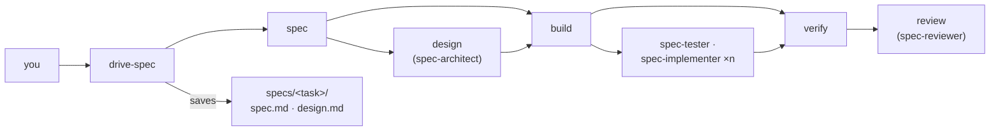

# my-workflow

A spec-driven software workflow for Claude Code and GitHub Copilot, for any language or framework.
Use it three ways: let **drive-spec** lead a task end to end, run the **skills** one at a time, or
ground unfamiliar code first with **code-auditor**. Renamed from `my-spec` in 1.0.

## Install

```bash
python3 setup.py install --tools claude,copilot --plugins my-workflow
```

Run it from a clone of this repo. It removes an old `my-spec` or `think` install. Needs Claude Code
2.1.219 or later.

## 1 · Drive a task: `/my-workflow:drive-spec`

```text
/my-workflow:drive-spec add rate limiting to the upload API
```

drive-spec acts as the tech lead in your session:

1. **Spec** — grounds what your request leaves open, checks claims it rests on, and shapes
   requirements and up to 3 questions with defaults.
2. **Track** — a small, clear change goes straight to build and verify, nothing saved. Anything
   bigger takes the full track below.
3. **Design** — only when an approach, structure, components, contracts or UI state is open.
4. **Build** — plan, then implement; spec-tester and parallel spec-implementers join only when they
   pay off.
5. **Verify and review** — every requirement checked with evidence, then an independent review with
   one fix round.

On the full track you answer at most two gates: the spec and design together, and the plan before
teammates build. Results are saved in `specs/<task>/` (git-ignored unless you want it committed, or
under a location you name): `spec.md` always, `design.md` when a design ran. To change direction, just
say so; drive-spec checks the impact, offers options and revises the spec.



## 2 · Use the skills one by one

Each skill does one job, picks up earlier results (a spec, design or plan) from the session or a file
you name, returns its result without saving it, and ends with an `Open:` line saying what is left.

| Skill | Use it to |
|---|---|
| `rephrase <prompt>` | Put the main objective of a long prompt first, and see what was dropped. |
| `audit-truth <question>` | Find out how something works, where it lives, or whether a claim is true. |
| `decide` | Choose an approach or stack and design only the parts needed. |
| `scaffold-project-structure` · `design-component` · `analyze-ui-state` | Design one part: the folder layout, components, or UI state. |
| `build` | Plan and implement with unit tests, then verify; or plan only; or just given tasks. |
| `verify [author \| run]` | Write failing acceptance checks before the code, or check every requirement after. |
| `critique` | Review a diff or design: verified findings and a verdict. |

All are invoked as `/my-workflow:<skill>`. A spec from skills alone looks like this, every step
optional:

```text
/my-workflow:audit-truth how does the upload client retry today?
/my-workflow:drive-spec add retry with backoff — the spec only
/my-workflow:decide
/my-workflow:build — the plan only
/my-workflow:build
/my-workflow:critique
```

Results carry over in the conversation. To keep them across sessions, ask to save one to a file you
name, then point later skills at it: `/my-workflow:build the spec at specs/upload-retry/spec.md`.

## 3 · Ground unfamiliar code first: `code-auditor`

```bash
claude --agent my-workflow:code-auditor "billing, to add refunds"
```

It maps the area into an atlas (an index plus a note per flow and structure, anchored to the source),
answers your questions from it, and adds what was missing. It ends with a line to paste into a new
session: `Atlas: <path>/INDEX.md — read it before the source.` Every skill there reads the atlas
first.

## Make it fit your stack with external skills

my-workflow names no language or framework. It brings in your stack's know-how at three moments:

| When | Skill | Asks the stack for |
|---|---|---|
| Design | decide and its parts | limits that shape structure, state, concurrency and lifecycle |
| Implement | build | idioms, APIs and pitfalls for the code being written |
| Review | critique | the stack's rules, as one more lens |

Sources, first match:

1. **Your project's rules:** CLAUDE.md, AGENTS.md, `.claude/rules`, ADRs.
2. **One installed skill** whose description names your stack and that phase.
3. **Built-in knowledge.**

API facts come from a documentation tool (an MCP server) at your stack's version, else official docs.

To write a skill my-workflow will pick up:

- Name the stack and the phase in its description, for example "<stack> review rules: …" or
  "<stack> service design limits: …".
- Keep its body to rules. my-workflow applies the rules but never runs the skill's own procedure or
  writes its output files.

## How it adapts

- **Your instructions come first.** A decision you state is kept, a path you name is read, "quick" or
  "deep" sets the depth, and "just do it" skips the stops.
- **Role fills the gaps.** drive-spec infers senior or junior from how you write, and shows it in the
  spec. Say "as junior", or put `my-workflow role: junior` in CLAUDE.md, to change it.
- **Claims are checked.** A statement the work rests on is verified first; a wrong one is corrected
  with evidence.
- **Steps and limits are defaults.** The model skips, merges or exceeds them when a task calls for
  it, and says why.
- **Coding principles.** build and decide follow [shared/principles.md](shared/principles.md): think
  before coding, simplicity first, surgical changes, goal-driven execution.

## Agents

| Agent | Role | Model · effort |
|---|---|---|
| `spec-architect` | Designs; returns the design to drive-spec. | opus · high |
| `spec-tester` | Writes acceptance checks before the code exists. | sonnet · medium |
| `spec-implementer` | Builds one batch of tasks with unit tests. | sonnet · medium |
| `spec-reviewer` | Reviews independently; edits nothing. | opus · high |
| `code-auditor` | Builds and grows a codebase atlas; runs on its own. | opus · medium |

drive-spec dispatches the first four. Copilot ignores the model names and runs agents on your session
model.

## Changes from my-spec 0.9

- Renamed to my-workflow. `explore` is now `audit-truth`; `start` merged into `drive-spec`; `write` and
  `steer` removed. New skills: `drive-spec`, `rephrase`, `verify`.
- New agents replace builder, writer, designer, explorer and reviewer.
- Skills return results; only drive-spec saves, as `spec.md` and `design.md` under `specs/<task>/`.
- Roles, claim checks, stack knowledge per phase, quality axes in review, readable templates, and
  coding principles.
