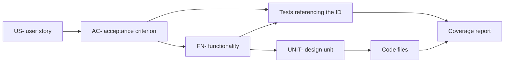

# Keeping Humans in Control of AI-Written Code: A Workflow Based on Verification, Design, and Determinism

**Status:** Draft v5
**Audience:** People who design, use, or review the AI development workflow
**Implemented by:** the `my-workflow` plugin; see `README.md` beside this file for usage.

## Abstract

When agents write the code, the developer's first-hand knowledge no longer backs the result, and the output arrives faster than anyone can review it. This document argues that confidence must then come from two places: the inputs that steer the agent (requirements and design) and checks on the output that do not depend on trusting the agent. It proposes a workflow built on three principles: formalized verification, design for maintainability, and deterministic mechanisms wherever they are available.

---

## 1. Introduction

Software development has a well-known shape: requirements, design, plan, implement, test, review. For decades each stage had a human owner, and the implement stage was where a developer's expertise turned into code they could stand behind.

AI models can now carry out the implement stage. That changes more than speed. It removes the mechanism that made the code trustworthy, and it leaves four specific risks behind.

The argument runs as follows:

- Section 2 describes the human workflow and where its confidence comes from.
- Section 3 describes what changes when agents implement.
- Section 4 names the resulting risks.
- Section 5 states three principles that answer them.
- Section 6 presents the solution.
- Section 7 checks the solution against the risks.

---

## 2. Background: the human workflow

A human workflow assigns each stage to a role:

| # | Stage | Owner |
|---|-------|-------|
| 1 | Requirements | Stakeholders, product managers |
| 2 | Design | Architect |
| 3 | Plan | Project managers |
| 4 | Implement | Developers |
| 5 | Test | QA |
| 6 | Review | Architect, staff developers |

The developer who writes the code is responsible for the outcome. Through daily work they accumulate detailed knowledge of the project, the language, and the framework, including the tricks and edge cases that never get written down. That knowledge is why they can be confident in their code, and why a reviewer can trust them.

Confidence in the human workflow is therefore a by-product of authorship.

---

## 3. What AI changes

Agents can take over the implement stage entirely. Two consequences follow.

**Authorship no longer produces confidence.** An agent writes code faster than a human can, and far faster than a human can review. The human did not write it and will rarely read all of it. Confidence has to be built deliberately, from clear inputs that steer the agent and from verification that does not rely on the agent's own word.

**Developers move upstream.** With implementation delegated, the developer's leverage is in requirements and design. Clear requirements and a good design are how a human controls what the agent builds.

| Stage | Human era | AI era |
|-------|-----------|--------|
| Requirements | Stakeholders, PMs | Stakeholders, PMs, **developers** |
| Design | Architect | Architect, **developers** |
| Plan | Project managers | Developers with agents |
| Implement | Developers | **Agents** |
| Test | QA | Agents, checked deterministically where possible |
| Review | Architect, staff developers | Humans, supported by verification evidence |

---

## 4. The problem: four risks

Even with good requirements and design, the agent's output remains uncertain in four ways.

| ID | Risk | Description |
|----|------|-------------|
| R1 | Unreviewable output | The volume and speed of generated code exceed human review capacity. |
| R2 | Unverified alignment | There is no reliable way to confirm the output satisfies the given requirements. |
| R3 | Unknown quality | Code quality is hard to evaluate. |
| R4 | Lost continuity | Humans can hardly continue the work if AI models become unavailable. |

A workflow for AI development is adequate only if it answers all four.

---

## 5. The approach: three principles

**P1. Formalized verification.** Outcomes are verified against artifacts defined in the requirements and design stages (user stories, acceptance criteria, functionalities), not against the agent's claim of completion. A human reviews the evidence instead of every line.

**P2. Design for maintainability.** A good design is easy to read, has clear responsibilities and boundaries between units, and uses few workarounds. It confines risk to well-bounded units that a human can still understand and take over.

**P3. Deterministic where possible.** Where a script, lint, schema, or similar mechanism can make a judgment or finish a piece of work, it is preferred over AI judgment. This is a best-effort principle: some stages have no deterministic way to decide, and there an AI or human judgment is acceptable as long as it is recognized as one.

---

## 6. The solution

### 6.1 Trace every requirement to a test and to code

Every user story, acceptance criterion, functionality, and design unit gets a stable unique ID, defined once in `spec.md` or in dedicated files that follow fixed templates.

- A requirement counts as covered only when a test references its ID.
- The code files relevant to each user story and acceptance criterion are tracked, so anyone can go from a requirement to the code that realizes it.
- A coverage report, produced by script where possible, shows per ID whether it is planned, implemented, tested, and passing.
- The test and review stages do not complete with uncovered IDs. An exception needs a waiver explicitly approved by a human.

### 6.2 Bound the implementation

- Implementation runs under the project's lints and formatter.
- Good practices come from two sources: the agent's own knowledge, and external input (user instructions, project docs, external skills). Practices that can be turned into enforceable checks should be.
- An agent does not report a task complete while checks fail, and does not silence a check to get past it.
- Implementation follows the approved design. If the implementer finds a gap between the design and what can actually be built, it raises the gap to the user, who decides what to do. It does not quietly deviate.

### 6.3 Invest in the design

- Design takes several iterations with a human; the workflow leaves room for them.
- The system is decomposed into units. A unit is a function, method, class, module, or component, and follows `Output = Unit(Input)`: it takes input from other units, processes it with its own internal logic, and delivers an output. A unit may contain smaller units.
- Each unit has a clear responsibility and boundary. Decomposition should be reasonable: enough that a human can understand a unit and take it over, which keeps risk contained. Making units as small as possible is not the goal.
- Mermaid diagrams show the dependencies between units.
- Workarounds are kept to a minimum, because a design that keeps relying on them eventually breaks. They usually appear when the implementer hits a gap between the design and the existing codebase that it cannot solve. A workaround can be raised at the design, implement, test, or review stage. Each one is explained to the user and needs the user's approval: the user may steer the design to avoid it, or accept it.
- Before approval, someone who did not produce the design (a human, or an agent with fresh context) reviews it.
- The workflow leaves the requirements stage and the design stage only when a human explicitly approves, or has given permission in advance to auto-advance. Otherwise it waits.

### 6.4 Prefer deterministic mechanisms, best effort

At each step, a deterministic mechanism is used when one exists and can decide the question. Where none exists, the step relies on AI or human judgment, and that is stated openly so reviewers know which results are checked and which are judged.

### 6.5 Stage gates

| Stage | Exit artifact | Gate |
|-------|---------------|------|
| Requirements | User stories, acceptance criteria, functionalities, all with IDs | Templates valid; criteria linked to stories; human approval or auto-advance permission |
| Design | Unit decomposition, Mermaid dependency diagrams, workaround list | Fresh-eyes review; workarounds approved; human approval or auto-advance permission |
| Plan | Tasks referencing IDs | Every ID is covered by a task |
| Implement | Code, code-file mapping per story and criterion | Lints and encoded practices pass; design gaps raised and decided; workarounds approved |
| Test | Tests referencing IDs, results | Every criterion and functionality has a passing test, or an approved waiver |
| Review | Coverage report, workaround list, review notes | No uncovered IDs without an approved waiver; no unapproved workarounds; human review |

---

## 7. Evaluation: does the solution answer the risks?

| Risk | How it is answered |
|------|--------------------|
| R1 Unreviewable output | The human reviews a coverage report, a diagram, and well-bounded units instead of every line. |
| R2 Unverified alignment | Each requirement has an ID, a referencing test, and tracked code files; the coverage report shows the gaps. |
| R3 Unknown quality | Quality is bounded by enforced checks, an implementation held to the approved design, user-approved workarounds, and an independent design review. |
| R4 Lost continuity | A readable design, well-bounded units, a dependency map, and a requirement-to-code mapping let a human pick up the work. |

What the solution does not do: it cannot prove that the requirements themselves are right, and it leaves some judgments (design quality, review, any step without a deterministic check) to humans or to an AI judge.

---

## 8. Conclusion

Moving implementation to agents removes authorship as the source of confidence. This workflow replaces it with three things: formalized verification that ties every requirement to a test and to code through stable IDs; a design built from clearly bounded units of reasonable size, drawn as dependency diagrams and reviewed with fresh eyes; and deterministic mechanisms wherever one can decide. With these in place, the human keeps control at the points that matter: approving the requirements and the design, deciding on design gaps and workarounds, approving any waiver, and reading evidence instead of trusting assertions.
