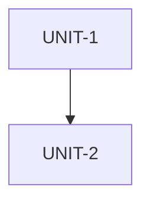

# Atlas format

Every write (build, distill, a query's fold-back) follows this and ends with the Format check.

## Files

- `INDEX.md` — this exact name; the only index.
- `units/<id>-<kebab-name>.md` — one per revealed unit; exactly one index row each.

## INDEX.md

````markdown
# Atlas — <scope>

Purpose: <the questions this atlas answers, one or two lines>
Audited: <date> at <commit>

## Start here
- <entry point or the rule most likely to bite> — `path:symbol`

## Graph


## Units
| Unit | Anchor | Owns solely | File |
|---|---|---|---|
| UNIT-1 <name> | `path:symbol` | <logic no other unit has> | units/UNIT-1-<name>.md · not revealed |

## Flows
- F1 <trigger → outcome>: UNIT-1 → UNIT-2 → <boundary>

## Gaps
- <unit or area not audited> — <why>
````

- Graph: top-level units only; every top-level table row is a node; an arrow points at what a unit depends on,
  labelled with what crosses. Too big to read → one diagram per connected group.
- "Start here": at most 5 lines.
- A unit touched by several flows is a hub: say so in its row.

## Unit entry

```markdown
---
id: UNIT-<n>
title: UNIT-<n> <name> — <what it is for>
anchor: <path:symbol>
keywords: <2–3-word search terms, comma-separated>
owns: <the logic it solely owns, one line>
source: <omit when read from source · distilled from <path>>
---

## Input
- <what> ← UNIT-<m> `path:symbol` · <boundary: actor, request, timer, table, key, event>

## Unit
- Owns solely: <rule, decision or state no other unit has>
- <what it does with the input: steps, guards, state it reads or writes>

## Output
- <what> → UNIT-<k> · <boundary: exact surface and shape>
- <case: error · empty · race · permission> → <result, state changed where>

## Sub-units
- UNIT-<n>.<m> <name> — `path:symbol` — <input → output, one line> · not revealed

## Dive
- `path:symbol` — <what deeper detail lives there>
```

- A sub-unit is a one-line row until a question needs it; then it gets its own entry
  (`units/UNIT-<n>.<m>-<name>.md`), an index row, and stays listed under its parent.
- Omit a section that does not apply.
- Untagged = read from source · (from <file>) = from notes, unchecked · (inferred) = deduced ·
  (uncertain) = carries a Dive pointer.

## Format check

```bash
find <atlas> -name '*.md'                                    # INDEX.md and exactly the indexed entries
grep -rL '^id: ' --include='*.md' <atlas> | grep -v INDEX.md  # must print nothing
grep -o 'UNIT_[0-9]*' <atlas>/INDEX.md | sort -u              # the graph's nodes = the table's top-level rows
```

Index rows and entry files match one to one. Fix every violation before returning.
