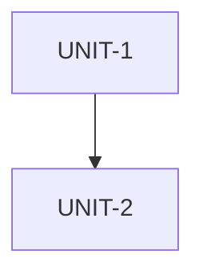

# Atlas format

Every write (build, distill, a query's fold-back) follows this and ends with the Format check.

## Files

- `INDEX.md` — this exact name; the only index.
- `units/<id>-<kebab-name>.md` — one per revealed unit; exactly one index row each.

## INDEX.md

````markdown
# Atlas — <scope>

Purpose: <the questions this atlas answers, one or two lines>
Audited: <date> at <commit>

## Start here
- <entry point or the rule most likely to bite> — `path:symbol`

## Graph


## Units
| Unit | Anchor | Owns solely | File |
|---|---|---|---|
| UNIT-1 <name> | `path:symbol` | <logic no other unit has> | units/UNIT-1-<name>.md · not revealed |

## Flows
- F1 <trigger → outcome>: UNIT-1 → UNIT-2 → <boundary>

## Gaps
- <unit or area not audited> — <why>
````

- Graph: top-level units only; every top-level table row is a node; an arrow points at what a unit
  depends on, labelled with what it takes. Too big to read → one diagram per connected group.
- Flows hold what the graph cannot: the order things run in and the way data moves.
- "Start here": at most 5 lines.
- A unit many others depend on is a hub: say so in its row.

## Unit entry

```markdown
---
id: UNIT-<n>
title: UNIT-<n> <name> — <what it is for>
anchor: <path:symbol>
keywords: <2–3-word search terms, comma-separated>
owns: <the logic it solely owns, one line>
depends: <the unit ids under Depends on, comma-separated; omit when none>
source: <omit when read from source · distilled from <path>>
---

## Depends on
- UNIT-<a> <name> — takes `<the surface it uses>` · <what for>
- <boundary: framework, endpoint, table, key, event> — <exact surface and shape>

## Owns
- Solely: <rule, decision or state no other unit has>
- <how it combines what it takes: steps, guards, state it reads or writes>

## Provides
- `<surface a dependent can take>` — <what it gets> · <case: error · empty · race · permission → result>
- Entered by: <actor, request, timer or event>

## Inside
- UNIT-<n>.<m> <name> — `path:symbol` — <what it owns, one line> · exposed | private · not revealed

## Dive
- `path:symbol` — <what deeper detail lives there>
```

- An edge is written once, by the unit that depends. Who uses a unit is never stored: it is the
  entries whose `depends` names it, plus the Graph.
- `Entered by`: entry points only.
- Inside: `exposed` is part of what the unit provides; `private` is not to be used from outside. A
  row stays one line until a question needs it; then it gets its own entry
  (`units/UNIT-<n>.<m>-<name>.md`), an index row, and stays listed under its parent.
- Omit a section that does not apply.
- Untagged = read from source · (from <file>) = from notes, unchecked · (inferred) = deduced ·
  (uncertain) = carries a Dive pointer.

## Format check

```bash
find <atlas> -name '*.md'                                    # INDEX.md and exactly the indexed entries
grep -rL '^id: ' --include='*.md' <atlas> | grep -v INDEX.md  # must print nothing
grep -o 'UNIT_[0-9]*' <atlas>/INDEX.md | sort -u              # the graph's nodes = the table's top-level rows
grep -rh '^depends:' <atlas> | grep -oE 'UNIT-[0-9.]+' | sort -u  # each has an index row
```

Index rows and entry files match one to one; the graph's edges are the top-level units' `depends`.
Fix every violation before returning.
