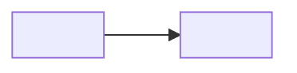
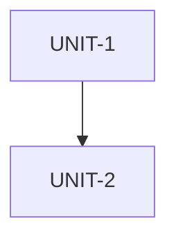

# Design — <title>

**Approach:** <the approach the user chose, one line>
Stack: <stack>

<!-- Final choices only, in phrases: no explanation, no options, no open questions. Delete a section
the design does not need. -->

## Context

Only when several systems are involved.

| System | Responsibility | Owns |
|---|---|---|

## Units

Change: new · modify · reuse (untouched).

| Id | Unit | Anchor | Responsibility | Change | Delivers | Group |
|---|---|---|---|---|---|---|
| UNIT-1 | <name> | `path:symbol` | <what it solely owns> | new | AC-1.1 | <group> |

## Dependencies

The one place dependencies are stated: an edge is what crosses. Up to 6 units → all of them, here;
more → one node per group here, its units drawn in `design/<group>.md`.

## Parts

- [structure](design/structure.md) · [flows](design/flows.md) · [contracts](design/contracts.md) ·
  [screens](design/screens.md) · [ui-state](design/ui-state.md) — only those this design needs

## Quality

| Axis or rule | How the design meets it | Enforced by |
|---|---|---|
| <axis a limit names · rule the design sets> | <how> | <lint rule or check · review> |

## Decisions

| Id | Decision | Why |
|---|---|---|
| D-1 | <what the user chose> | <why> |
