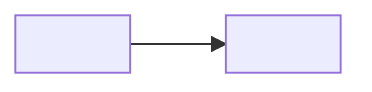
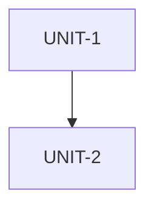

# Design — <title>

**Approach:** <the approach the user chose, one line>
Level: module | component | system · Stack: <stack>

<!-- The high-level view only. Final choices, in phrases: no explanation, no options, no open questions.
One unit (module level, light size): no design/ folder; add Input (from), Output (to) and Boundary
columns to the Units table and put its Interface here.
Sections by level; delete the rest.
| Section      | module | component | system |
| Context      | —      | —         | yes |
| Units        | yes    | yes       | yes (per deployable) |
| Dependencies | —      | yes       | yes |
| Parts        | —      | as needed | as needed |
| Quality      | —      | if a limit names it | yes |
-->

## Context

| System | Responsibility | Owns |
|---|---|---|

## Units

Change: new · modify · reuse (untouched).

| Id | Unit | Anchor | Responsibility | Change | Delivers | File |
|---|---|---|---|---|---|---|
| UNIT-1 | <name> | `path:symbol` | <what it solely owns> | new | FN-1 · AC-1.1 | design/UNIT-1-<name>.md |

## Dependencies

The overview. Up to about 5 units → all of them; more → one node per group of units, each unit's own
neighbours drawn in its file. Never more than 6 units in one diagram.

## Parts

- [structure](design/structure.md) · [flows](design/flows.md) · [contracts](design/contracts.md) ·
  [screens](design/screens.md) · [ui-state](design/ui-state.md) — only those this design needs

## Quality

| Axis or rule | How the design meets it | Enforced by |
|---|---|---|
| <axis a limit names · rule the design sets> | <how> | <lint rule or check · review> |

## Decisions

| Id | Decision | Why |
|---|---|---|
| D-1 | <what the user chose> | <why> |
