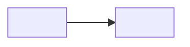
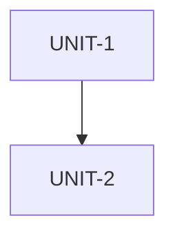
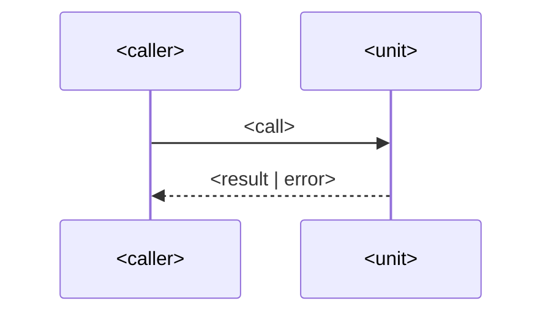

# Design — <title>

**Approach:** <the approach the user chose, one line>
Level: module | component | system · Stack: <stack>

<!-- Final choices only: options, trade-offs and open questions stay in the conversation.
Sections by level; delete the rest. At most one diagram and one table per section (Screens and UI
state: as many as their screens and state units need).
| Section            | module     | component     | system |
| Context            | —          | —             | yes |
| Structure          | —          | if new        | if new |
| Units              | yes        | yes           | yes (per deployable) |
| Dependencies       | ≥2 units   | yes           | yes |
| Interface          | yes        | per new unit  | — |
| Interactions       | if async   | yes           | yes |
| Screens · UI state | —          | if UI         | if UI |
| Contracts and data | if changed | if changed    | yes |
| Quality            | —          | if a limit names it | yes |
-->

## Context



| System | Responsibility | Owns |
|---|---|---|

## Structure

## Units

`Output = Unit(Input)`. Change: new · modify · reuse (untouched).

| Id | Unit | Anchor | Responsibility | Input (from) | Output (to) | Boundary | Change | Delivers |
|---|---|---|---|---|---|---|---|---|
| UNIT-1 | <name> | `path:symbol` | <one sentence: what it solely owns> | <what> ← UNIT-2 · <actor> | <what> → UNIT-3 | <what it never does or exposes> | new | FN-1 · AC-1.1 |

## Dependencies

Every unit is a node, every dependency an edge, no cycle.



## Interface

| Unit | Operation | Input | Output | Errors | Invariant |
|---|---|---|---|---|---|

```text
<signatures only, in the project's language>
```

## Interactions



## Screens

```text
┌──────────────────────────────┐
│ <title>             [action] │
├──────────────────────────────┤
│ <region>                     │
└──────────────────────────────┘
```

| Screen | Shows | Actions | Loading · empty · error |
|---|---|---|---|

## UI state

## Contracts and data

| Boundary | Shape and version | Errors and failure | Data owner |
|---|---|---|---|

- Migration: <steps, each shippable alone, and the rollback>

## Quality

| Axis or rule | How the design meets it | Enforced by |
|---|---|---|
| <axis a limit names · rule the design sets> | <how> | <lint rule or check · review> |

## Decisions

| Id | Decision | Why |
|---|---|---|
| D-1 | <what the user chose> | <why> |
