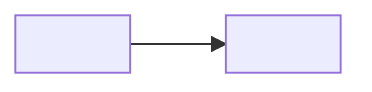
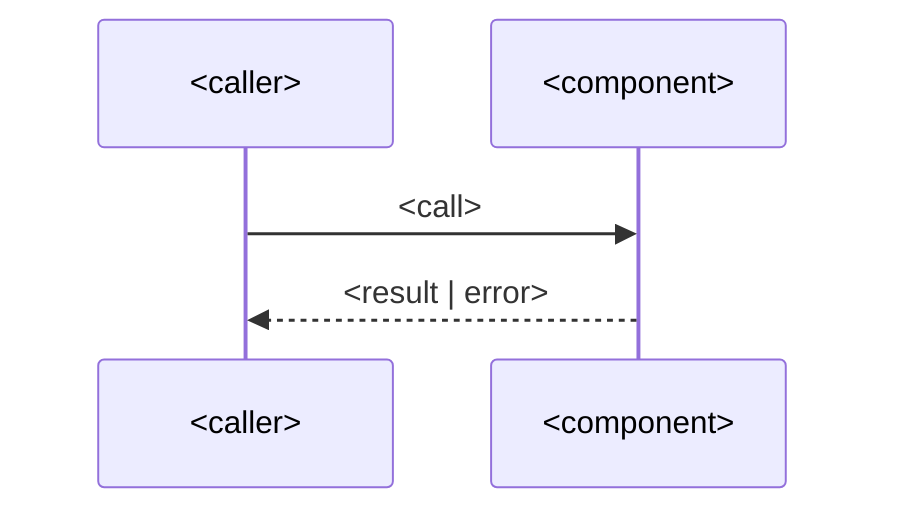

# Design — <title>

**Recommendation:** <one line> — would change if <…>.
Level: module | component | system · Stack: <stack | open>

<!-- Sections by level; delete the rest. At most one diagram and one table per section.
| Section            | module | component | system |
| Approach           | if open    | if open       | if open |
| Context            | —          | —             | yes |
| Structure          | —          | if new        | if new |
| Components         | —          | yes           | yes (per deployable) |
| Interface          | yes        | per component | — |
| Interactions       | if async   | yes           | yes |
| Screens · UI state | —          | if UI         | if UI |
| Contracts and data | if changed | if changed    | yes |
| Quality            | —          | if a limit names it | yes |
-->

## Approach

| Option | How | Pros | Cons | Effort (S/M/L) | Risk if it fails |
|---|---|---|---|---|---|

## Context



| System | Responsibility | Owns |
|---|---|---|

## Structure

## Components

## Interface

| Operation | Input | Output | Errors | Invariant |
|---|---|---|---|---|

```text
<signatures only, in the project's language>
```

## Interactions



## Screens

```text
┌──────────────────────────────┐
│ <title>             [action] │
├──────────────────────────────┤
│ <region>                     │
└──────────────────────────────┘
```

| Screen | Shows | Actions | Loading · empty · error |
|---|---|---|---|

## UI state

## Contracts and data

| Boundary | Shape and version | Errors and failure | Data owner |
|---|---|---|---|

- Migration: <steps, each shippable alone, and the rollback>

## Quality

- <axis the spec's limits name> — <how the design meets it>

## Coverage

| Story or criterion | Met by |
|---|---|
| US1 · AC1.1 | <section or component> |

## Decisions

- D<n> <decision> — <why>

## Open questions

- Q<n> <question> — default: <answer>

Open: <questions, and any requirement that must change — or nothing>
