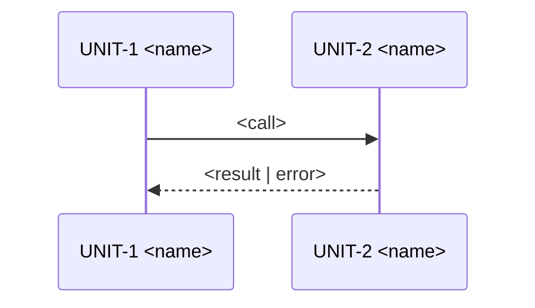

# Design parts

One file per part under `design/`, only those the design needs. Phrases; no explanation.

## design/structure.md

```text
<tree, a `# role` comment per entry>
```

| From | May import | Enforced by |
|---|---|---|

## design/flows.md

One per story or trigger that crosses units; at most 6 participants each.



## design/contracts.md

| Boundary | Shape and version | Errors and failure | Data owner |
|---|---|---|---|

- Migration: <steps, each shippable alone, and the rollback>

## design/screens.md

```text
┌──────────────────────────────┐
│ <title>             [action] │
├──────────────────────────────┤
│ <region>                     │
└──────────────────────────────┘
```

| Screen | Shows | Actions | Loading · empty · error |
|---|---|---|---|

## design/ui-state.md

The § UI state that `/my-workflow:analyze-ui-state` returns.
