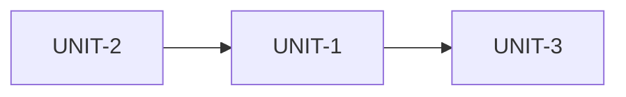

# UNIT-<n> <name>

<!-- design/UNIT-<n>-<name>.md. Phrases, one line each; omit a section that does not apply. -->

## Input

- <what> ← UNIT-<m> · <actor>

## Output

- <what> → UNIT-<k>
- <error · empty · race> → <result>

## Boundary

- <what it never does or exposes>

## Neighbours



## Interface

New or changed surface only.

| Operation | Input | Output | Errors | Invariant |
|---|---|---|---|---|

```text
<signatures only, in the project's language>
```

## Inside

Only when a builder could not guess it: state it owns, an async path, units inside it.

| Id | Unit | Anchor | Responsibility |
|---|---|---|---|
| UNIT-<n>.1 | <name> | `path:symbol` | <what it solely owns> |
