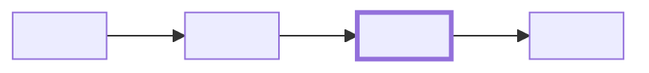

# <title>

**Verdict:** valid | needs reproduction | not a bug — <why, in one line>
Kind: bug · Severity: critical | high | medium | low — <impact, reach, data risk> · Source: <link or
"pasted report">

## Symptom

| | |
|---|---|
| Observed | <what happens> |
| Expected | <what should happen> — <anchor: doc, test or contract that says so> |
| Conditions | <version, environment, data, how often> |

## Reproduction

1. <step>
2. <step>

`<command>` → <output that shows the symptom> · or: not reproduced — <what is missing>

## Root cause

**<the fault in one sentence>** — confidence: high | medium | low. Introduced by: <change, or unknown>

| Step | Where | What happens | Evidence |
|---|---|---|---|
| <step> | `path:line` | <fact> | run · read |

Also affected: <other callers of the same cause — or none>

## Fix options

### Option A (preferred) · effort S | M | L

- **Change:** <shape of the change>
- **Files:** <paths>
- **Risk:** <what it could break>

## Acceptance criteria

### AC-1 When <the reproduction runs>, <the expected behaviour>

- **Given:** <the reproduction's state>
- **Evidence:** ⬜ → `<command>` · observed: <what was done and seen>

### AC-2 When <a neighbouring case runs>, <still behaves as before>

- **Given:** <only when it matters>
- **Evidence:** ⬜ → `<command>` · observed: <what was done and seen>

## Decisions

| Id | Decision | Why or anchor | From |
|---|---|---|---|
| D-1 | <decision> | <why> | request · Q-<n> · discussions #<n> |

## Open questions

- Q-1 <question> — default: <answer>

<!-- Light size only: the design and review live here instead of their own files. -->
## Design

## Review

Open: <questions, and what stayed unverified — or nothing>
